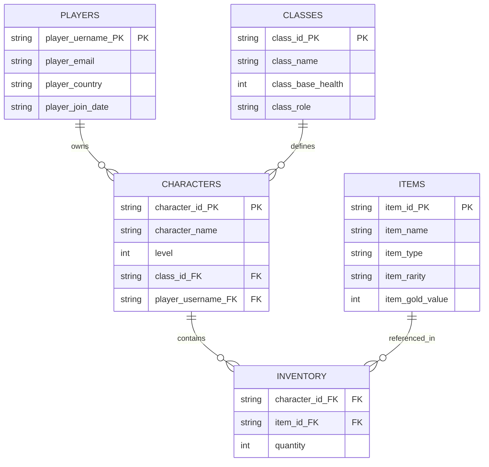

**Before you start:** rename this file to `unit3e_Game_lastname.md`, using your own last name. Read `unit3e_Walkthrough.md` and `unit3e_Game_Client.md` first. Commit and push when you're done.

**Name: Michael M.**

**Partner(s): Max R.**

---

# Unit 3e — Design a Database for a Client: Game Studio

Both partners turn in the same design.

**Something we disagreed on, and how we settled it: Didn't disagree**


**Link to our Google Sheet (or the file name if you committed the xlsx):**


## 1. The client's spreadsheet

Look at the `Client_Export` tab.

**a.** Which column breaks 1NF? Which 1NF rule does it break?

**Answer: inventory, multiple values in one cell**


**b.** Player NightOwl_22 has three characters. How many times is their email typed in the client export? What has to happen if they change their email? What is that problem called?

**Answer: 3, update anomaly, because you would have to xhange it for every instances**


**c.** Can `character_name` be the primary key of a characters table? Why or why not? What should the key be instead?

**Answer: No, as the game allows characters to be named the exact same. Character ID**


## 2. First normal form

Look at the `1NF` tab. Each row is one item that one character is carrying.

**d.** What is the primary key of the 1NF table? Why does it take more than one column?

**Answer: character ID and Item name. Because the table is about the items per character,**


## 3. Second normal form — the whole key

For each column, check what it depends on: the character, the item, or both. Use your 1NF key from **d**.

| Column | Depends on the character? | Depends on the item? | Needs the whole key? |
|---|:-:|:-:|:-:|
| `level` | yes| no| no|
| `player_email` | yes| no| no|
| `item_rarity` | no| yes| no|
| `item_gold_value` | no| yes| no|
| `quantity` | yes| yes| yes|

**e.** Columns that depend on only part of the key have what problem? Which tables did you move them into?

**Answer: unnecessary fields, character table (Character key), inventory table (full key), items table (Item Key)**


## 4. Third normal form — nothing but the key

**f.** `class_base_health` is in the characters data, but it doesn't really depend on the character. What does it depend on? What is that problem called?

**Answer: Class, redundency**


**g.** The player's email and country also depend on something other than the character. What?

**Answer: Player/User**


## 5. The client's mistakes

When you used Remove duplicates, two tables had one row too many. Find both mistakes.

| Table | What was wrong | What we kept |
|---|---|---|
| Character| Had user info repeated| username of the player|
| Inventory| repeated character's name and player info| character ID|

**h.** Why would these mistakes be impossible in your finished design?

**Answer:**


## 6. Our tables

For each table, list every column and mark keys as `(PK)`, `(FK)`, or `(PK, FK)`. Give the number of rows your table has in the Sheet.

| Table | Columns | Rows |
|---|---|:-:|
| PLAYERS | player_uername (PK), player_email, player_country, player_join_date| 16|
| CLASSES |class_id (PK), class_name, class_base_health, class_role |5 |
| CHARACTERS |character_id (PK), character_name, level, class_id (FK), player_username (FK) |26 |
| ITEMS |item_id (PK), item_name, item_type, item_rarity, item_gold_value |15 |
| INVENTORY |character_id (FK), item_id (FK), quantity |80 |

**i.** Fill in the relationships. **Choose from:** one-to-one · one-to-many · many-to-many

| Relationship | Type | Where is the foreign key? |
|---|---|---|
| PLAYERS → CHARACTERS | one-to-many| username|
| CLASSES → CHARACTERS | one-to-many| class_id|
| CHARACTERS ↔ ITEMS | many-to-many| character_id and item_id in Inventory junction table|

**j.** Which table is the junction table? What is its primary key?

**Answer: Inventory, character_id and item_id**


## 7. ER diagram (AI writes the code)

Give your tables to AI and have it write the Mermaid code. Proof it and test it on mermaid.live. Then paste it here.



**Paste the prompt you gave the AI:**

```text
using this EXCEL file, make mermaid code to represent the tables and their columns with the Primary key and FOreign key labeled as it is in the file
```

**k.** What did you have to fix in the AI's diagram? If nothing, what did you check?

**Answer: no fixes, I checked to make sure it was correctly linked up with proper names**


## 8. Check your design

- [ ] Every table has a primary key
- [ ] Every many-to-many goes through a junction table
- [ ] No cell holds a list
- [ ] No fact is stored in two places
- [ ] Every foreign key points at a primary key in another one of our tables

**Which normal form does your design reach, and how do you know?**

**Answer: 3N, as it follows 1n with no lists/one value per cell, follows 2n with every dependable using the full key rather than half the key, and 3n with no non-key atrributes needing another non-key attribute**


## Swap

Trade with a **different** pair. Run their design through the checklist in Part 8. Write one specific thing you'd change about theirs.

**Their names:**

**Feedback for the other pair:**